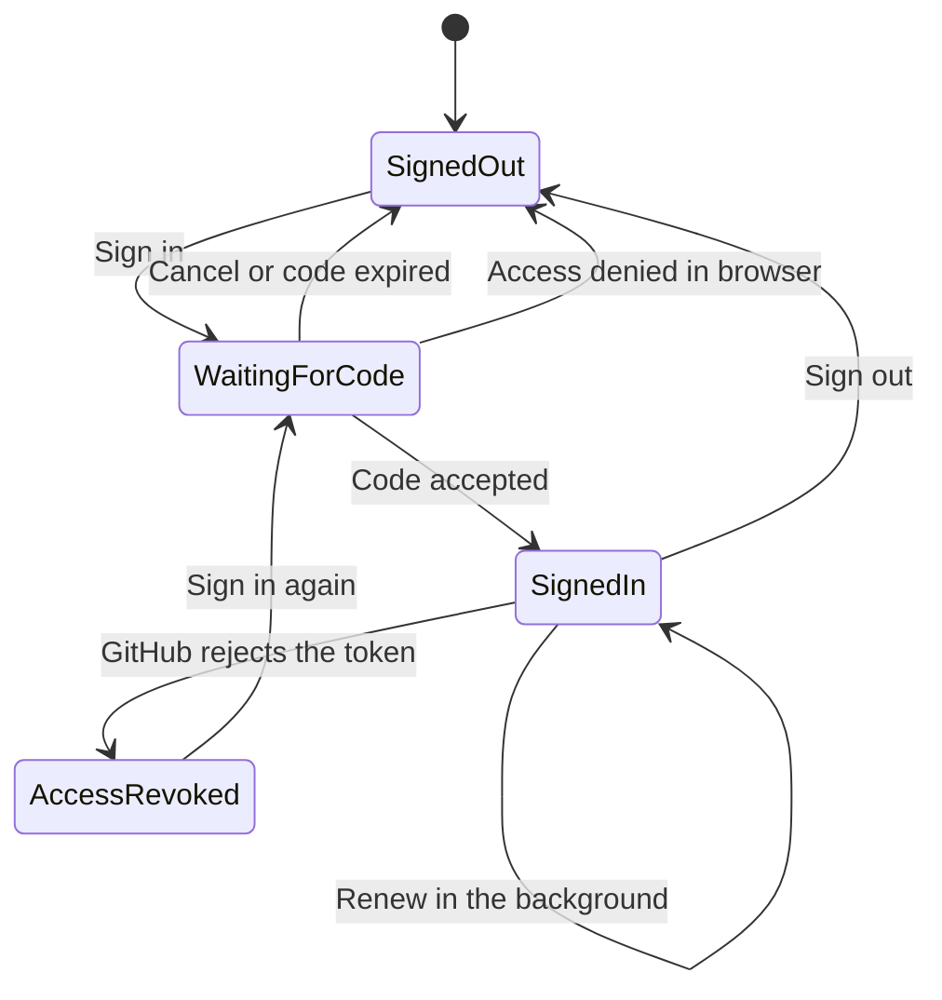
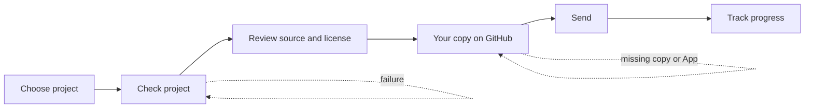
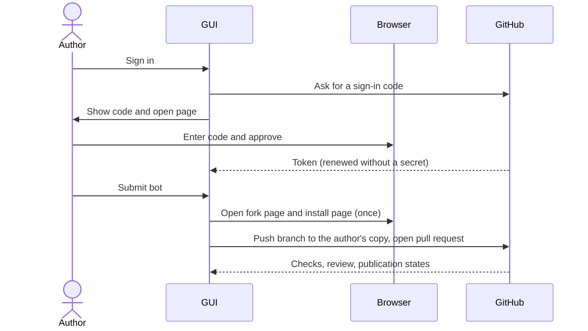

# Rumble menu mockups and participant journeys

These text mockups show what a person sees in the planned **Rumble** menu and how they move through it. They are for the maintainer's review before any screen is built; they fix what each screen says and does, not its pixels. The [target participation design](participation.md) owns the shared interfaces and the sign-in rules these screens rely on. Nothing here describes shipped functionality.

The menu bar gains one entry between Config and Help:

```text
Battle   Server   Config   Rumble   Help
                           ┌──────────────────────┐
                           │ Get started          │
                           │ Submit or update bot │
                           │ My bots              │
                           │ Download bots        │
                           │ Contribute battles   │
                           │ Results and queue    │
                           │ Rankings             │
                           │ GitHub account       │
                           │ Help                 │
                           └──────────────────────┘
```

Local bot creation and normal battles never need a GitHub account. A screen that needs one says so on the screen and offers the sign-in right there, instead of failing later. Every screen shows the environment it is talking to in its title bar, for example `Rumble (public Beta)`, and an advanced setting can switch to the development Rumble with a persistent warning, as the participation design requires.

## Get started

```text
┌ Rumble (public Beta) ─────────────────────────────────────────────┐
│ The Rumble is a continuous league: authors submit bots, and        │
│ anyone can lend computing time to run the battles.                 │
│                                                                    │
│  ┌───────────────┐  ┌────────────────────┐  ┌───────────────────┐  │
│  │ Make a bot    │  │ Submit a bot       │  │ Contribute battles│  │
│  │ Starter in    │  │ Check it, then     │  │ Run ranked battles│  │
│  │ Java, C#,     │  │ send it to the     │  │ on this computer. │  │
│  │ Python or     │  │ Rumble.            │  │ Needs a GitHub    │  │
│  │ TypeScript.   │  │ Needs a GitHub     │  │ account.          │  │
│  │ No account.   │  │ account.           │  │                   │  │
│  │ [Create bot]  │  │ [Submit a bot]     │  │ [Contribute]      │  │
│  └───────────────┘  └────────────────────┘  └───────────────────┘  │
│ This is a Beta. Report problems: [Open feedback page]              │
└────────────────────────────────────────────────────────────────────┘
```

"Create bot" opens the existing Battle, Create bot wizard. The other two buttons open the screens below and start the sign-in first if the person is not signed in.

## GitHub account

The account screen is the one place that explains what signing in means. Signing in uses a short code, never a password and never a token the person copies by hand.

```text
Not signed in                         Waiting for you in the browser
┌ GitHub account ─────────────────┐   ┌ Sign in with GitHub ──────────────────┐
│ You are not signed in.          │   │ 1. Open github.com/login/device       │
│ You need an account to submit   │   │    [Open page]  (the code is copied)  │
│ bots and contribute battles.    │   │ 2. Enter this code:                   │
│                                 │   │                                       │
│ [Sign in with GitHub]           │   │            F94F-59CF                  │
└─────────────────────────────────┘   │ Waiting... code expires in 14:32      │
                                      │                           [Cancel]    │
                                      └───────────────────────────────────────┘
Signed in
┌ GitHub account ────────────────────────────────────────────────────┐
│ Signed in as robocode-rumble-test.                                  │
│ Registered with client ID robocode-rumble-test-1dcccf64.            │
│ Authorization renews by itself.                                     │
│ [Sign out]   [How to revoke access]                                 │
└─────────────────────────────────────────────────────────────────────┘
```



| Situation | What the person sees | What they can do |
|---|---|---|
| The code expires | "The code expired. Nothing was changed." | [Get a new code] |
| They press Cancel or deny access in the browser | "Sign-in was cancelled." | [Sign in with GitHub] |
| GitHub is unreachable | "GitHub cannot be reached. Try again when you are online." | [Try again] |
| Authorization was revoked | "GitHub access was revoked. Your queued results are kept." | [Sign in again] |

The first sign-in also registers the account with the Rumble automatically and shows the client ID it received. Registering again returns the same client ID.

## Submit or update bot

First versions and updates use the same steps. The wizard keeps the original project untouched and works on a staged copy.



```text
Step 1 of 6  Choose project           Step 2 of 6  Check project
┌─────────────────────────────────┐   ┌──────────────────────────────────────┐
│ Folder: C:\bots\Scout   [Browse]│   │ Checking Scout 1.0.2 (Java)          │
│ Found: Scout 1.0.2, Java        │   │  ✓ Metadata is complete              │
│ Owner: robocode-rumble-test     │   │  ✓ Launcher scripts can be run       │
│ [Make a new bot instead]        │   │  ✗ Version 1.0.2 already exists.     │
│                    [Next]       │   │    Change the version to 1.0.3.      │
└─────────────────────────────────┘   │ [Fix and check again]                │
                                      └──────────────────────────────────────┘
Step 3 of 6  Review                   Step 4 of 6  Your copy on GitHub
┌─────────────────────────────────┐   ┌──────────────────────────────────────┐
│ This will be published:         │   │ You need your own copy of            │
│  Name and version: Scout 1.0.3  │   │ robocode-dev/rumble-bots.            │
│  Source files: 14 (list)        │   │ 1. [Open fork page]  press Fork      │
│  License: MIT (declared)        │   │    Waiting... found: no              │
│ Anyone can read, run and learn  │   │ 2. [Open install page] choose only   │
│ from this source.               │   │    your copy rumble-bots             │
│       [Back]   [I agree, Next]  │   │    Waiting... found: no              │
└─────────────────────────────────┘   └──────────────────────────────────────┘
Step 5 of 6  Send                     Step 6 of 6  Track
┌─────────────────────────────────┐   ┌──────────────────────────────────────┐
│ Creating branch... done         │   │ Checks      passed                   │
│ Adding files... done            │   │ Review      waiting for a moderator  │
│ Opening pull request... done    │   │ Published   not yet                  │
│ [Open pull request in browser]  │   │ In rankings not yet                  │
└─────────────────────────────────┘   │ [Open pull request]                  │
                                      └──────────────────────────────────────┘
```

The author needs a copy of the bot repository in their own account because the bot repository takes changes only as pull requests. A copy belongs to its author and stays under their control, which is why the wizard sends them to the web page that creates the copy and to the page that installs the Rumble App on it; GitHub does not let the desktop program create the copy for them. Both pages are opened for them and the wizard detects the result by itself, so the person only presses two buttons in the browser. Later submissions and updates reuse the copy and skip step 4.

| Situation | What the person sees | What they can do |
|---|---|---|
| A check fails | The failing check with the exact change needed | [Fix and check again] |
| The copy or the App is missing | Step 4 shows which of the two is not found yet | [Open fork page] or [Open install page] |
| The pull request cannot be opened | The reason GitHub gave, in plain words | [Try again], [Open fork page] |
| The review asks for changes | Track screen shows "Changes requested" with a link | [Open pull request] |
| Sending is interrupted | The wizard resumes at step 5 with nothing sent twice | [Continue] |

Checks, review, publication and visibility in the rankings are separate states, as the participation design requires.

## My bots

```text
┌ My bots ──────────────────────────────────────────────────────────────┐
│ Name        Version  Language  State                  Actions         │
│ Scout       1.0.3    Java      Waiting for review     [Open] [Update] │
│ Orbit       1.0.0    Python    In the rankings        [Open] [Update] │
│ Retcon      0.2.0    Java      Changes requested      [Open] [Update] │
│                                                                       │
│ [Submit a new bot]                                                    │
└───────────────────────────────────────────────────────────────────────┘
```

The list reads from the Rumble and from the local projects, and shows each bot's state in the same four separate states as the Track step. Withdrawing a bot is a later milestone and is not on this screen yet.

## Download bots

This screen copies competitor bots from the Rumble into a folder of their own so the person can read them and practise against them. It needs no GitHub account, because the catalog is public. It is planned for a later milestone than the other screens.

```text
Choose bots                                  Result
┌ Download bots ──────────────────────────┐  ┌ Download bots ───────────────────────────┐
│ Which bots?   (o) All active bots       │  │ Downloaded 41 of 43                      │
│               ( ) Selected bots         │  │  ✓ Orbit 1.0.0     MIT          new      │
│ Platform:     [x] Java [x] .NET         │  │  ✓ Scout 1.0.3     MIT          updated  │
│               [x] Python [x] TypeScript │  │  ✗ Fire 2.1.0      hash differs, skipped │
│ Bot       Version  License   State      │  │  ! Retcon 0.2.0    kept, no longer active│
│ [x] Orbit 1.0.0    MIT       new        │  │ [Show folder]   [Download again]         │
│ [x] Scout 1.0.3    MIT       update     │  └──────────────────────────────────────────┘
│ [ ] Retcon 0.2.0   MIT       retired    │
│ Save to: C:\Users\me\rumble-bots        │
│          [Change]                       │
│ Bots you download are other people's    │
│ code and run with your rights. Moderator│
│ review does not make them safe.         │
│ [Download]                              │
└─────────────────────────────────────────┘
```

The default folder is `rumble-bots` beside the person's normal bots directory and can be changed. It is added to the bot directories automatically and labelled, and in New Battle its bots appear as a collapsed group after the person's own bots, so their own bots always come first:

```text
New Battle: bots
┌─────────────────────────────────────────┐
│ ▼ My bots                               │
│     MyFirstBot   1.0                    │
│     Walls        0.3                    │
│ ▶ Rumble bots (downloaded, 41)          │
└─────────────────────────────────────────┘
```

Only bots that are active in the catalog are offered for a new download; a retired bot appears in the list only if it was downloaded earlier. The state column says new, update, up to date, or retired. A retired or disqualified bot that was downloaded earlier stays in the folder and is marked, and is removed only when the person removes it. A downloaded bot never replaces one of the person's own bots, even when the names match. Ranked contribution never reads this folder and uses only the pinned catalog.

| Situation | What the person sees | What they can do |
|---|---|---|
| Offline or interrupted | "Downloaded 12 of 43. The rest can be continued." | [Continue] |
| A bot's hash does not match | The bot is skipped and listed as failed with its name and version | [Download again] |
| The folder cannot be written | "This folder cannot be written. Nothing was downloaded." before anything is fetched | [Change] |
| A downloaded bot has the same name as one of the person's own | "Kept in the download folder only. Your own bot is unchanged." | [Show folder] |
| A downloaded bot is no longer active | It stays, marked "no longer active" | [Remove] |
| The catalog is unreachable or unsupported | "The Rumble catalog cannot be read." | [Try again] |

## Bot info in New Battle

The Bot Info panel in New Battle shows the selected bot's details from its configuration file. Today it shows name, version, authors, homepage, description, platform, programming language, game types and countries. It gains two rows, **License** and **Team members**, and it applies to every bot in the person's bot directories, downloaded or not (a bot that joined from another computer has no configuration file here, so those rows show "not available"), because the license matters to anyone who reads or copies another person's code.

```text
Bot Info
┌──────────────────────────────────────────────────────────────────┐
│ Name       Orbit                  Platform      Python           │
│ Version    1.0.0                  Language      Python           │
│ Authors    A. Author              Game types    1v1, melee       │
│ Homepage   https://example.org    Countries     Denmark (dk)     │
│ License    ● Free to copy: MIT    Team members  (none)           │
│ Description  Orbits its target and fires at a steady rhythm.     │
│ Folder     Rumble bots (downloaded)  C:\Users\me\rumble-bots\Orbit│
└──────────────────────────────────────────────────────────────────┘
License levels, always shown as an icon and words, never colour alone:
  ● Free to copy        MIT, BSD, Apache-2.0, ISC, Unlicense, CC0: keep the copyright notice
  ▲ Copy with conditions  GPL, LGPL, AGPL, MPL, CC-BY: your copy must be shared under the
                          same terms, or credit the author
  ■ Do not copy         No license declared, an unrecognised or proprietary license, or a
                        no-derivatives or non-commercial license: all rights are reserved
```

The level is a reading aid for the license the bot itself declares; the panel cannot check that the declaration is true, and it is not legal advice. The tooltip says so and links to the license text. A bot with no `license` field shows "No license declared" at the do-not-copy level, because the law's default is that nobody may copy it. Bots accepted into the Rumble always carry an allowed license, so a downloaded bot is never at the do-not-copy level; a local bot can be. The Download bots screen uses the same levels beside each bot's license. A team's members are listed by name and version. The folder row tells the person whether a bot is their own or downloaded, which also separates two bots with the same name. The description stays cut to three lines in the panel, with a link that opens the full text.

## Contribute battles

```text
Before starting                        While running
┌ Contribute battles ───────────────┐  ┌ Contribute battles ──────────────────┐
│ Which bots?                       │  │ Running 1 battle   Completed: 12     │
│  (o) All bots                     │  │ Scout vs Fire (1v1)  round 14 of 35  │
│  ( ) Prefer selected bots         │  │ Next: Orbit vs Retcon                │
│  ( ) Only selected bots           │  │ Results: 12 queued, 10 sent          │
│ Bots: [x] Scout  [ ] Orbit  ...   │  │ [Pause]   [Stop]                     │
│ Formats: [x] 1v1 [ ] TwinDuel     │  │                                      │
│          [ ] Melee                │  │ Waiting example:                     │
│ Limits: 1 battle at a time,       │  │ No valid matchup for the selected    │
│         CPU 50%, memory 2 GB      │  │ bots in strict mode. Waiting, not    │
│ Stop after: (o) 50 battles        │  │ using your computer elsewhere.       │
│             ( ) Keep running      │  └──────────────────────────────────────┘
│ [x] Send results automatically    │
│ [Start]                           │  Stop asks: [Finish this battle, then
└───────────────────────────────────┘  stop]  [Stop now and discard it]
```

The three bot modes follow the participation design: **All bots** lets the Rumble pick, **Prefer selected bots** picks a valid battle with a selected bot first and falls back otherwise, and **Only selected bots** never runs a battle without one. Pause finishes the active battle. A stopped or cancelled battle never becomes a ranked result. The screen never offers a way to favor good results.

## Results and queue

```text
┌ Results and queue ─────────────────────────────────────────────────────┐
│ Completed 120  Queued 8  Sent 100  Accepted 98  Rejected 2  In rankings 90 │
│                                                                        │
│ Batch   Battles  Sent        Receipt                                   │
│ 41      10       10:42       Accepted                                  │
│ 40      10       10:31       2 rejected: duplicate battle   [Details]  │
│ 42      8        waiting     Queued, will retry in 2 min               │
└────────────────────────────────────────────────────────────────────────┘
```

| Situation | What the person sees | What they can do |
|---|---|---|
| Not signed in, or access revoked | "Sending is paused. 8 results are kept." | [Sign in again] |
| GitHub unreachable or rate limiting | "Will retry automatically." with the next try time | [Retry now] |
| Part of a batch is rejected | The rejected battles with GitHub's reasons | [Details] |
| The engine changed under queued results | "These results are from an older engine and are kept apart." | [Learn more] |

Results are saved before they are sent, so an interrupted program loses none of them.

## Rankings and Help

**Rankings** opens the selected environment's dashboard in the default browser and needs no sign-in. **Help** opens the central participant documentation at `https://robocode.dev/rumble/`. Neither has a screen of its own.

## Who does what


