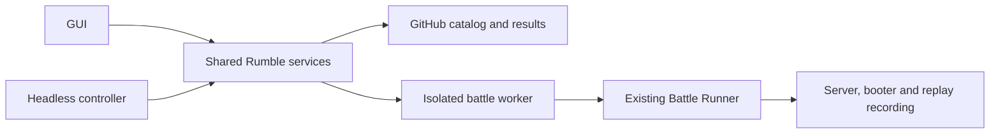

# Target Rumble participation flows and environment boundaries

This is the target design for the [replacement campaign](../../plans/P-007-rumble-participation.md), not a description of shipped functionality. Existing capability criteria continue to describe the supported client until their implementing changes replace them. This document owns shared interfaces and boundaries; capability-local algorithms and schemas belong with their implementing criteria.

## Modules and process boundaries

| Component | Responsibility |
|---|---|
| New `lib:rumble` | Synchronization, scheduling, session state, GitHub integration, registration, durable queue, receipts, and typed status models; no Swing dependency |
| New `rumble` executable | Headless session controller and isolated worker entry point, with the same behavior as the GUI-managed session |
| New `lib:bot-project` | Starter generation, source inspection, submission staging, metadata validation, and validation orchestration |
| Existing GUI | Wizards, bot management, contribution controls, and presentation |
| Existing runner, server, booter, recorder | Battle execution and existing lifecycle responsibilities |
| Catalog and result repositories | Moderation, authoritative source catalog, registration, ingestion, and ranking projections |

The host owns credentials and upload authorization. Workers receive a pinned job and constrained source/evidence locations, and return typed results, replay references, and diagnostics. They never receive GitHub credentials, the host home directory, or a container-engine socket. Host/worker commands and events are versioned and machine-readable; callers never parse human logs. Unknown versions fail with an actionable error. GUI events are dispatched without blocking Swing's event thread. The GUI manages a separate controller and stops its managed session on exit; independent background operation uses the CLI. Reuse the replay viewer for finished battles; live contribution-battle visualization is deferred.

## Environments and account boundary

The existing `rumble-bots` and `rumble-data` repositories and `https://robocode-dev.github.io/rumble-data/` remain the public Beta. The implementation creates `rumble-bots-test` and `rumble-data-test` under `robocode-dev` only after checking that those names are available and not occupied by unrelated work. Name conflicts are a maintainer decision, not permission to repurpose an existing repository. The development dashboard belongs to the test result repository. Share workflow sources or pinned reusable workflows; deployment inputs select the environment.

Environment identity is carried through configuration, catalog/result discovery, registrations, caches, journals, submissions, and reset tooling. Public and test state have separate roots and authorization installations. The receiver verifies its own environment; client-side labels are insufficient. Ordinary installations default to public Beta. Advanced environment selection shows a persistent development warning; switching never retargets an existing pending queue. Legacy state is imported as public state after source/destination verification, with the original retained until successful migration.

GitHub identity is required for publishing and ranked contribution, not local bot creation or practice. Use device authorization and Windows credential storage; never request a password or hand-copied personal token. Keep contribution authorization separate from additional publishing permissions. Prove token renewal, revocation handling, outside-account issue intake without caller-applied labels, fork/PR permissions, and publication-first receipts in the test environment. Never ship an application secret in the desktop client. The experiment must record permissions actually exercised; a maintainer-token success does not count.

Automatic registration derives account identity from the authenticated request, checks bans and duplicates, and assigns or retains a stable installation client ID. Trusted repository workflows make authoritative changes. A payload cannot choose another owner or grant itself authority. Preserve existing registrations. No hosted broker is authorized; an incompatible permission boundary requires a reviewed decision.

## GUI and bot authoring

One top-level **Rumble** menu contains **Get started**, **Submit or update bot**, **My bots**, **Contribute battles**, **Results and queue**, **Rankings**, **GitHub account**, and **Help**. **Rankings** opens the selected environment's dashboard in the default browser without sign-in; public Beta uses `https://robocode-dev.github.io/rumble-data/`. **Help** opens the central participant documentation. **Battle → Create bot** is also available from Rumble's getting-started screen, and normal local battles stay separate from ranked contribution.

Create runnable Java, C#, Python, and TypeScript projects with consistent names, metadata, launchers, and pinned dependencies. Authors use their own editor and chosen language runtime. Submission must not require a host Git install, unrelated runtime, manual executable-bit changes, or manual JSON repair. Stage existing projects separately without rewriting their original files. Run validation, show actionable failures, then show the exact source and license declaration before a user publishes. Automate fork, branch, commit and PR creation; preserve ownership, version, and moderation rules. Track checks, review, publication, and active-catalog visibility separately. First versions and updates share this flow.

## Contribution sessions and result durability

Contributors choose **All bots**, **Prefer selected bots**, or **Only selected bots**. Multiple entries may be chosen regardless of ownership; preferences follow active versions. TwinDuel selections identify team entries. Prefer mode chooses a valid selected-entry battle before falling back; strict mode requires at least one selected entry in every battle. Opponents come from all eligible entries. If no valid strict matchup exists, wait and explain rather than spending compute elsewhere. Missing advice does not make an otherwise valid matchup impossible. Rotate fairly across selected entries, use coverage to choose opponents, and preserve ranked eligibility rules.

Start with one concurrent battle, configurable CPU/memory limits, selected game formats, and a battle-count bound or continuous operation. Rotate across selected formats. Pause finishes the active battle; stop offers finish-and-stop or cancel-now. Incomplete or cancelled battles never become completed ranked records. Live viewing is not needed to contribute.

Completed ranked results reach the durable journal before upload. When automatic submission is enabled, complete batches retry and collect publication-first receipts without manual per-batch posting. Preserve pending records across process interruption, network failure, revocation, rate limiting, and partial rejection. Quarantine incompatible engine epochs. Show completed, queued, submitted, accepted, rejected, and ranking-publication states separately. Never expose a favorable-result selection filter. Migrate existing journals, receipts, replays, client IDs, and `myBots` preferences non-destructively.

## Withdrawal and test cleanup

Owners withdraw their own entries; moderators may withdraw any entry. Preview the exact version and dependent teams before confirmation. Withdrawal excludes the entry from new matchmaking and current rankings and frees its active-entry slot, but preserves ownership, source history, accepted facts, and archived snapshots. Existing current-ranking rules exclude complete matchups containing an inactive participant, so opponents' current APS may change; the confirmation explains that effect. Disqualification remains a separate moderation action.

Dependent teams become ineligible without withdrawing unrelated member bots. Explicit restoration is permitted only if source/version ownership, active-version, dependency, and moderation rules still hold. Withdrawing a member does not silently substitute another member or version. Stale queued results are handled with explicit receipts under the resulting eligibility contract, never deleted without explanation.

The first public cleanup withdraws the then-active versions of the identified test bots `RumbleTestScout` and `Orbit`. Resolve their ownership, exact versions and all dependent teams from the catalog at execution time; the initial observation included an `OrbitVector` team, but the operation uses the current dependency graph. Preview and record these exact identities, then revalidate immediately before mutation. If a version or dependency changed, refresh the preview rather than withdrawing an unseen version. Unrelated bots remain untouched. Public test entries are withdrawn, not purged. Reset tooling operates only on explicitly selected development resources, previews the reset scope, and rejects public repository IDs and state paths. Test resets create a fresh test generation so old queued data cannot repopulate the reset environment.

## Readable dashboard and metadata

Leaderboard links open HTML detail pages with shareable bot identity, game format, and ranking period. Format-specific data must not overwrite another format's bot shard. Retain machine-readable JSON as a secondary link and preserve compatibility during migration. Existing archived snapshots stay immutable; where their old bot detail shard represents the wrong format, derive available statistics from that archive's selected-format leaderboard rather than pretending the shard is correct. Show missing information honestly.

Display name, version, authors/owner, description, language/platform, license, supported formats, lifecycle state, source link, and team members when relevant. Show rank, APS, battle and matchup counts, and update time for the selected format/period. Render text safely, validate outbound links, and keep provenance clear for historical metadata. Descriptive metadata changes should not force a strategy version reset where they do not change execution inputs.

Only maintainers grant **Official sample bot** status through trusted catalog metadata; submitters cannot self-certify it. Official samples remain ranked benchmarks. A visibility filter hides/shows their rows without recalculating APS or competitive rank. Beating samples is a learning target, not an entry gate; a badge does not promise a uniform difficulty across formats. Unknown historical sample metadata remains unknown rather than being silently backfilled.

## Documentation and verification

`https://robocode.dev/rumble/` is the canonical participant home. Keep repository-specific implementation contracts close to their code, and link other participant entry points to central instructions. Audit all organization repositories, not just the three Rumble repositories; record update-required, aligned, unrelated, historical-only, or inaccessible outcomes. Preserve established URLs or supply redirects. Public Beta wording describes what currently works and distinguishes the planned GUI. Update public instructions when the corresponding feature is available, not ahead of it.

M-029 delivers lib:bot-project and the initial integration harness; M-031 delivers author metadata, while M-033 delivers the trusted sample-metadata schema/update path and projections. Their dependencies are explicit in the campaign table. M-037 completes and verifies one documented local integration command with isolated fixture state, simulated GitHub responses, and real container battles where needed, producing a short report and redacted diagnostics. Use the development Rumble for real outside-account GitHub tests. A short public-Beta smoke check remains necessary because test installation permissions do not prove live installation permissions. Before public mutations, persist a run manifest identifying every intended and created bot/team/version. Finish by withdrawing every temporary entry through normal lifecycle operations and verifying its removal from active published rankings and matchmaking, while preserving accepted facts and snapshots. Failed or interrupted tests retain a resumable cleanup obligation; unresolved withdrawal prevents the final milestone from completing. The maintainer checklist asks for observations, not manual transcription of IDs and versions. Windows is the initial complete journey acceptance target; no evidence from a prepared machine is presented as a clean install.
