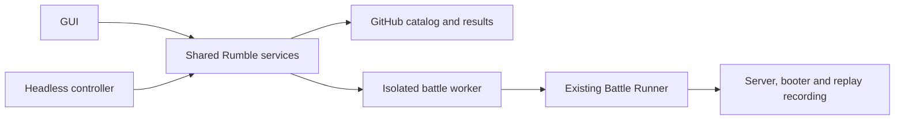
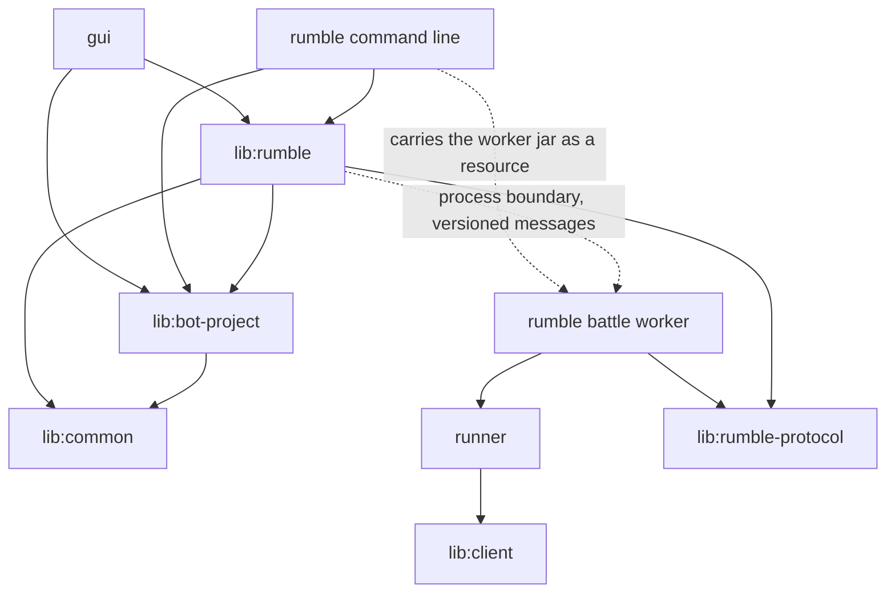

# Target Rumble participation flows and environment boundaries

This is the target design for the [replacement campaign](../../plans/P-007-rumble-participation.md), not a description of shipped functionality. Existing capability criteria continue to describe the supported client until their implementing changes replace them. This document owns shared interfaces and boundaries; capability-local algorithms and schemas belong with their implementing criteria.

## Modules and process boundaries

| Component | Responsibility |
|---|---|
| New `lib:rumble` | Synchronization, scheduling, session state, GitHub integration, registration, durable queue, receipts, and typed status models; no Swing dependency. Today it holds the Rumble environments with their repositories and per-environment state folders, a pending queue bound to one environment, an automated check of its dependency rules, reading of the bot catalog with hash-verified fetching of bot sources (the caller supplies the catalog commit), GitHub sign-in with a code plus renewal of the sign-in, saving the sign-in between runs in one protected file shared safely between programs, registering the signed-in account through a registration issue with the client ID kept with the sign-in, sending a staged bot as a pull request from the account's own copy of the bot repository, an advisory pre-check of a staged bot against the Rumble's owner list, ban list and catalog, a read-only reader of where a bot's pull request stands, the host side of the battle worker (starting it in a clean environment with limits and returning one typed outcome), and the copy of the old Rumble client's state into the new state folder; the rest arrives in later changes |
| New `lib:rumble-protocol` | The versioned host and worker messages: a job, the worker's events, the stable error and exit codes and a one-message-per-line codec that refuses an unknown schema version whole. Plain data with no other Rumble or runner code, so the host library and the worker can both read it. Unpublished |
| New `rumble` command line (`rumble-cli`) | The controller: a headless program that a person, a script or an AI agent runs, with the same behavior as the GUI-managed session. It is a runnable jar with its dependencies, started with `java -jar`. Today it has the commands `version`, `environments`, `status` and `import-legacy`, which only read or are safe to repeat, and `login`, `logout` and `register`, which sign in, sign out and register under the rules for an agent's account below, and `bot check`, `bot send` and `bot status`, which check, send and follow a bot; commands that run battles come in later changes. It carries the battle worker's jar inside itself as a resource and extracts it when it is needed |
| New battle worker (`rumble`) | The isolated worker, its own small runnable jar with the runner and the messages inside it and none of the controller's code. It reads one job from standard input, requires the job's engine pin from the battle runner, runs the battle and writes events to standard output. It is started by the controller through the worker host in the shared library and never run by a person |
| New `lib:bot-project` | Starter generation, source inspection, submission staging, metadata validation, and validation orchestration. Today it inspects a bot or team folder and validates it against the bot repository's per-folder rules, listing every problem with a code and the change that fixes it; it can also stage a project as a separate copy laid out like the bot repository, with only the files a bot is made of, Unix line endings and the launcher recorded as executable, checked again and described with its content hash; the content hash is computed here. The rest arrives in later changes |
| Existing GUI | Wizards, bot management, contribution controls, and presentation. It calls the shared libraries in its own process, with the command line as a second front end over the same libraries; it never depends on the command line or the battle worker |
| Existing runner, server, booter, recorder | Battle execution and existing lifecycle responsibilities |
| Catalog and result repositories | Moderation, authoritative source catalog, registration, ingestion, and ranking projections |

The host owns credentials and upload authorization. Workers receive a pinned job and constrained source/evidence locations, and return typed results, replay references, and diagnostics. They never receive GitHub credentials, the host home directory, or a container-engine socket. Host/worker commands and events are versioned and machine-readable; callers never parse human logs. Unknown versions fail with an actionable error. GUI events are dispatched without blocking Swing's event thread. The GUI manages a separate controller and stops its managed session on exit; independent background operation uses the CLI. Reuse the replay viewer for finished battles; live contribution-battle visualization is deferred.

### Module dependencies

An arrow means "depends on". The rules below are what keeps the credential boundary real and the shared library free of desktop code; the build already fails when `lib:rumble` depends on the desktop program or the battle runner or imports a Swing or AWT class, and when `lib:bot-project` depends on the desktop program, the runner or `lib:rumble`, or imports Swing, AWT or a network client, and the check for the credential rule arrives with the worker.

- **The shared library has no desktop code.** `lib:rumble` never depends on Swing or on the `gui` module, so the GUI and the headless controller behave the same.
- **Only the host holds credentials.** GitHub tokens, registration and upload authorization live in `lib:rumble` and the command line. The worker, a separate program, depends on the runner and `lib:rumble-protocol` only, and the build fails if it depends on anything else of the Rumble code or names a token, the home folder or a container socket; it cannot reach the GitHub code and is started with no token, no home directory and no container socket.
- **The worker is reached only through versioned messages.** `lib:rumble` starts and talks to the worker across a process boundary with machine-readable commands and events. It does not depend on the runner, so replacing how battles run does not touch session logic. The messages live in their own small unpublished module, `lib:rumble-protocol`, and not in `lib:common`, which is published to Bot API users; they carry an integer `schemaVersion` like the other Rumble documents and are not JSON schemas in the `schema` folder, which describe the battle protocol with bots. The engine pin is the server's behavior version, checked by the battle runner, and is separate from the message schema version.

**The command line and the worker are two programs.** The design first spoke of one executable with a controller mode and a worker mode. A single jar that can be both would carry the controller's code and the saved sign-in, and the credential boundary requires that the worker's classpath holds none of that, so there are two: `rumble` (the command line, the controller) and the worker, which the command line carries inside itself as a jar resource, off its own classpath, and extracts into its state folder when it needs it, the way the battle runner carries the server and the booter. A person or an agent only ever runs `rumble`.

**The command line contract.** Every command answers as short text for a person or, with `--json`, as one JSON document with a schema version; it never asks anything on the keyboard; it ends with exit code 0 (done), 1 (failed, and the answer says what to do next), 2 (refused or bad input), 3 (a sign-in is needed) or 4 (not finished, so run the same command again); bad input answers in the form asked for; the environment is chosen with `-e`, `--environment` or the variable `RUMBLE_ENVIRONMENT`, is otherwise the public Rumble, and is named by every answer; the answers of `login`, `logout` and `register` carry an `outcome` word, and they and `status` give the next command as it can be run; the state folder can be chosen with `--state-folder`; and the answers hold no token, no device code, no home folder and no absolute path of the computer, while web addresses stay whole. The operating system user name is removed only from text that comes from outside the program, unless it is the participant's public GitHub account name, because a user name can be any word and must not change the program's own words. **Checking, sending and following a bot.** `rumble bot check <folder>` validates a bot or team folder offline against the bot repository's per-folder rules and lists every problem with its code, file and fix; it needs no sign-in, contacts nobody and writes nothing. `rumble bot send <folder> -e <environment>` checks the bot, checks that the account has its own copy of the bot repository with the sign-in App installed (what only the person can do: it answers `setup-needed` with the page to open and changes nothing), stages the bot into the state folder, checks it against the environment's owner list, ban list and catalog (advisory: an unreadable catalog does not stop the send and is said so), and sends it as one pull request. `--dry-run` does everything except the sending. `rumble bot status <name>` reads where the bot's pull request stands: waiting for the checks, being checked, sent back with the reason, waiting for a moderator, accepted, merged, in the catalog or closed. Sending to the public Rumble is refused until it has a sign-in App.

**What is published cannot be taken back.** `bot send` is the first command that publishes something under the participant's name. The bot repository is public, so everything in the bot's files becomes public the moment it is sent, anyone can read and copy the source under the license it declares, and it stays in the history even if the pull request is closed. Every answer of `bot send`, also a dry run and a refusal, says so as a fact (`sourceIsPublic`, the notice and the files that become public), in both forms, also in the test environment. **The desktop program must show the same notice on its sending screen and require the person to confirm it before it sends.** The author's license confirmation, that they have the right to publish the bot under its license, is the option `--certify-license`: never a default, not remembered, set by no configuration, repeated in the answer and in the pull request text. An agent passes it only when its person has told it to for that bot; the program cannot tell who typed it, so this is a rule for the agent that the person enforces by reading what it does. **The first real send.** On 2026-11-05 a bot was sent from the command line to the test environment with a real account: sign-in, registration, a check, a dry run, the send and the status all worked, and the automatic checks of the bot repository ran on the pull request; the maintainer then closed it, and no bot entered the catalog. Two facts came out of it. The program cannot make the copy of the bot repository for the person: GitHub refuses it, with 403 "Resource not accessible by integration", for a sign-in made through the Rumble sign-in App, so the person makes the copy on the web and installs the App on it once, and the desktop program must guide that step. And the moderation asked a person to look at the bot because its two launcher scripts differed from the starter launchers. The dry run and the send now compare them as the moderation does (the starter launcher of the language with `StarterBot` replaced by the bot's name, `\r\n` read as `\n`, nothing else normalised, read from the bot repository's default branch with the account's sign-in) and answer `same`, `differs` or `not-checked` with the reason, the file and the fix; a difference does not stop the send, because a person may want a custom launcher, and `bot check` stays offline and only says that the comparison happens at the dry run. Still unproven: building the branch from the Rumble's current head instead of from the copy's own main branch, which GitHub may refuse when the copy is behind (the copy was made just before the send), other operating systems than Windows, and the public environment, which has no sign-in App yet.

**How the program reaches people.** The command line is not carried inside the desktop program, so the desktop jar does not grow and the server and the booter do not lie in it several times. The desktop program fetches it the first time contributing battles need the battle worker inside it, because signing in, registering, checking, sending and following a bot run in the desktop program's own process and need no fetch; it asks first and shows the size, because this is code that will run on the computer. It takes the worker out of `rumble.jar` the way the command line does. It fetches exactly the release `v<version>` of its own version and exactly the file `robocode-tankroyale-rumble-cli-<version>.jar`, over HTTPS from github.com and never "latest", from an address the program builds itself from the version and the name, never one taken from GitHub's answer; downloads it under a temporary name with a size ceiling; checks the size and the SHA-256 against what GitHub reports for the asset in its API, and refuses an asset for which GitHub reports no hash; asks the temporary file for its version with `--version`, which must be the desktop version; and only then moves it into place, so a file of the wrong version is never left where an agent looks for the program. The file lives at `<user data folder>/rumble/rumble.jar`, a fixed place a person or an agent can run with `java -jar`. A failure gives a plain, typed answer (no release, no such file in the release, no hash, a file too big, the request limit, offline, a download that did not finish, a hash or version that does not match, a file in use) and leaves nothing half done: no temporary file and an earlier good copy untouched. It affects nothing else in the desktop program; the Rumble needs the network anyway. The library asks first by design: it plans the fetch and gives the size and the source, and only fetches what a screen then asks it to, so nothing is fetched in silence. A local build, whose version number equals the latest release's, points at its own jar with `-Drumble.jar=<path>`, and then nothing is fetched; a name that points at nothing is answered as such and never falls back to fetching in silence. People without the desktop program can fetch the same jar from the release page, so no Maven Central artifact is needed. The hash from GitHub protects against interrupted and damaged files, not against a compromised release; the desktop program comes from the same place, so no new party is trusted. A hash built into the desktop program cannot work, because the installers are built separately on each operating system and the jars differ between builds. For people who use the Rumble, the server and the booter do lie on the disk twice, once in the desktop program and once in the command line, which lets the command line stand alone. The release now uploads the program as one of its assets, the release's smoke test runs it, and a library in the shared Rumble library finds, plans and fetches it, proved against a fake GitHub and with the real built jar as the downloaded file. Releases made before this one hold no such file, so a desktop program of those versions finds nothing to fetch and says so. Still unproven: one real fetch from a real release that holds the file, which only a release can provide, and the calls from the desktop program, which come with the Rumble menu. **An agent works with the participant's own account.** As [decided](../../decisions/ADR-053-agent-uses-participants-account.md), an AI agent acts for one participant, with that participant's GitHub account and saved sign-in, so registrations, pull requests and results carry the participant's name, as the registration and the one open pull request per bot per account already assume. An agent with an account of its own is not supported; adding it needs a later decision with rules for registration, ownership of a bot and the rankings, and a person who answers for it. The commands that sign in follow these rules: an agent may start a sign-in, hand the code to its person and register the account that person approved, while the person approves the sign-in at GitHub, and an agent never approves it in a browser or creates an account; `login` answers at once with the code and `login --finish` checks for approval, with the waiting code kept in the sign-in's file between the two runs, its pace kept and the lock held for one check at a time, so `logout` waits for at most one request to GitHub and no sign-in appears after it has answered; every sign-in the person approves gets an identity of its own, and whatever is learned afterwards, like an account name or a finished registration, is saved only while that sign-in is still the saved one, so a registration that finishes after the sign-in has changed saves nothing and asks to be run again; a command that needs a sign-in and finds none, or one that cannot be used, ends with exit code 3, says so in its JSON answer and asks nothing; no answer shows a token; a command works on one environment at a time and never mixes the public and the test environment. An agent that runs as the participant's operating system user can read the saved sign-in, as a bot could; that is accepted for the agent, which acts for the participant, and the battle worker is what keeps bots away from it.

The host starts the worker with an environment built from an allowlist, never by removing names that look dangerous: the path and the Java and .NET locations, a few language and Windows system settings, and the worker's own new empty working, temporary and home folders. No token, home folder, container engine address or other variable is passed, and the bots the worker starts inherit the same environment. It stops the worker and everything it started when the total time, the amount of output or the length of one line passes a limit, and it throws the worker's diagnostic output away. The host also sets the home and temporary folders through the environment variable every Java process reads at start (`JAVA_TOOL_OPTIONS`), because Java on Windows learns the real home folder from the operating system and ignores the home variable; without it the server, the booter and every Java bot the worker starts would still see the real home folder, whatever command started the worker. Each such process prints one notice line about it on its standard error. **Closed ordinary ways**, each checked with a real process: the environment, the home and temporary folders of every Java process in the tree, the user data folder and the saved sign-in store's default location (a worker finds nothing saved), the worker's command line and standard input (the job and nothing else), the worker's classpath (no host, bot project, desktop or GitHub code) and the messages (no field named like a credential). The saved sign-in is also tied to the user name and home folder it was made for, so a copy cannot be opened from the worker's different home folder. **What this does not protect against:** a bot running as the participant's own operating system user can still open files by their full path, including the saved sign-in file, and can use a container engine socket whose path it knows. Only a container or a separate operating system account would stop that, and a bot that learns the original user name and home folder from somewhere else, such as a path in an error message, could rebuild the key that binds the saved sign-in; the bare-metal fallback accepts that residual risk knowingly. A passing test of the clean environment is not a promise of more.
- **Project tooling knows no GitHub.** `lib:bot-project` inspects, stages and validates a project and returns a typed staged submission. `lib:rumble` takes that value and does the fork, branch, commit and pull request work. The staging code never needs a token.
- **The desktop program uses the libraries in its own process.** As [decided](../../decisions/ADR-054-desktop-program-uses-rumble-libraries.md), a screen calls `lib:rumble` and `lib:bot-project` directly, not the command line, which is a second front end over the same libraries for people without the desktop program and for agents. The libraries are small (about 0.6 MB together) and the large part of the command line is the battle worker, which the desktop program cannot link. The desktop program holds the sign-in token in its own memory, which is accepted because it runs no bots and the saved sign-in file is as readable to the same user either way. The desktop build checks that it depends on neither the command line nor the worker, and the test of that rule has a deliberate violation that it must report.
- **Nothing depends on the GUI.** Dependencies point from the GUI and the executable down to the libraries, never back.

## Downloading competitor bots

A Robocoder can download selected or all active competitor bots into a folder of their own; the [Download bots screen](gui-mockups.md) and the matching [use case](../../use-cases/UC-005-download-competitor-bots.md) show the journey. The rules:

- **Optional and public.** Downloading needs no GitHub sign-in, because the catalog and the bot sources are public. Nothing is downloaded unless the person asks.
- **Verified and pinned.** Only bots that are active in the pinned catalog commit are offered for a new download. Each bot's source is checked against the content hash the catalog records before it is placed in the folder, and a bot that fails is skipped and reported. The same catalog fetch and verification that ranked contribution uses is reused, so there is one implementation of it in `lib:rumble`.
- **Licensed and visible.** Every bot is published under a declared license that permits copying. The screen shows each bot's license before the download and keeps it with the bot's files.
- **A license level for every bot.** The Bot Info panel in New Battle and the download screen show the declared license with one of three levels, always as an icon and words: free to copy, copy with conditions (copyleft or credit required), or do not copy (no license declared, an unrecognised or proprietary license, or a no-derivatives or non-commercial license). The level is a reading aid for what the bot declares and is not legal advice. The GUI already receives the license and team members in its own boot entry, so the panel reads them by the bot's directory; no change to the game protocol is needed.
- **A separate folder.** The default is a `rumble-bots` folder beside the normal bots directory, and the person may choose another. The GUI adds it to the bot directories with a label, and shows its bots in New Battle as a collapsed group after the person's own bots. The folder is never one of the person's own bot directories unless they choose it explicitly.
- **Never overwrites.** A downloaded bot never replaces one of the person's own bots, even when the names match. Updates replace only earlier downloads of the same bot.
- **Withdrawn bots are marked, not erased.** A bot the Rumble later retires, withdraws or disqualifies stays in the folder, marked as no longer active, until the person removes it.
- **Ranked contribution does not use the folder.** Ranked battles use only the pinned catalog and its verified sources. Downloaded bots are for reading and for practice battles.
- **Untrusted code.** A downloaded bot is another person's code. In a practice battle in the GUI it runs with the user's own rights, like any bot in the normal directory. Moderator review and the container used for ranked battles do not extend to that case, so the screen says so and the design does not call downloaded bots safe.

Module ownership follows the dependency rules above: catalog fetch, hash verification and the download operation belong to `lib:rumble` and return typed results with no Swing code, and the GUI owns the folder choice, the label and the New Battle grouping. The bot-directory setting today records only a path and whether it is enabled, so a label for the downloaded folder needs an extended setting. The change that builds it must read the existing setting without losing entries.

## Environments and account boundary

The existing `rumble-bots` and `rumble-data` repositories and `https://robocode-dev.github.io/rumble-data/` remain the public Beta. The test environment is the repositories `rumble-bots-test` and `rumble-data-test` under `robocode-dev`, created after checking that those names were free, with its dashboard at `https://robocode-dev.github.io/rumble-data-test/`. The test dashboard carries a visible Test badge, a banner and a Test page title so it cannot be mistaken for the live one. Its two GitHub Apps, `tank-royale-rumble-moderator-test` and `tank-royale-rumble-publisher-test`, have the same permissions as the public Apps, are installed only on `rumble-bots-test`, and keep their keys as Actions secrets there; `rumble-data-test` has no App because the result repository uses none. A third public App, `tank-royale-rumble-contrib-test`, is the sign-in App for participants and keeps no secret; it is installed on `rumble-data-test` and on a participant's own fork of the bot repository. The test bot repository has its own main-branch moderation ruleset that requires the test moderator App's status check. Name conflicts are a maintainer decision, not permission to repurpose an existing repository. The development dashboard belongs to the test result repository. Share workflow sources or pinned reusable workflows; deployment inputs select the environment.

Environment identity is carried through configuration, catalog/result discovery, registrations, caches, journals, submissions, and reset tooling. Public and test state have separate roots and authorization installations. The receiver verifies its own environment; client-side labels are insufficient. Ordinary installations default to public Beta. Advanced environment selection shows a persistent development warning; switching never retargets an existing pending queue. Legacy state is imported as public state after source/destination verification, with the original retained until successful migration.

**The fixture check.** One command, `./gradlew rumbleFixtureCheck`, runs the offline checks of `lib:rumble-protocol`, `rumble`, `lib:rumble` and `lib:bot-project` and the Python checks in `scripts/rumble` (including the reset tool's), groups them into named cases (environments and reset boundaries, sign-in and registration, catalog download and staging, bot submission and progress, and the battle worker and its host), and writes `build/rumble-fixture/result.json` and `report.md` through `scripts/rumble/fixture_report.py`. A new test class that belongs to no case is reported as a problem, and a case that ran no checks fails, so a check cannot disappear from the report by being forgotten. Secrets and machine details are removed automatically, and the files are scanned again so that the command refuses to write a file that still looks like it holds a secret; this is not proven complete. The command never runs a live check and refuses to start when the live switch is on, so a local fixture run cannot write to a public resource; the report lists the live checks it skipped, and says in every run that fixture success does not claim anything about the sign-in App on a real fork, public installation permissions or a real account. Later feature slices add their cases to it, and the final milestone completes the matrix with container battles and simulated GitHub responses. It is also described in the development guide.

**Import of the old client's state.** `LegacyClientImport` in the shared library copies the separate, older Rumble client's state without changing or losing any of it. It reads the old `rumble-client.json` strictly (schema version 1 only; a relative work folder is taken relative to the file), works out the Rumble environment from the two repository addresses with the same exact-match rule as everywhere else (a public address paired with a test address, an unknown address or a bot address in place of a result address is refused before anything is copied), and previews what it would copy. It then copies the `journal` and `evidence` folders byte for byte into a folder of imported old state below that environment's state folder, each file first under a temporary name, checked against the source by SHA-256 and only then given its final name, and writes a record last, which is the only thing that says the import is complete. The client ID and the own-bot preferences are also saved as a small typed record in that environment's folder only (a placeholder or empty client ID counts as not set). The old files are only ever read: never moved, changed or deleted, and the old folder is never written into; removing them is a separate later decision. The bot cache is not copied, because it can be downloaded again and checked against the catalog. Nothing is converted: the journal, the receipts and the replays are preserved verbatim for the session slices to read, and because a journal copied while the old client runs can end in a broken last line, whatever reads the copy must handle that. A file that changes while it is read is reported as changed and is copied by the next run, and an interrupted import is completed by running it again.

The environment names, repositories and dashboard addresses live in one data file in the shared library, `lib/rumble/src/main/resources/dev/robocode/tankroyale/rumble/environments.json`, which the library and the reset script both read. Test reset lives in Tank Royale as `scripts/rumble/rumble_environments.py`, so the later shared integration harness can call it. It knows exactly four repository names, read from that file, two public and two test, and treats a repository as a test repository only on an exact match of owner and name, so a lookalike or foreign name is refused. A reset works on a local checkout of the test results repository, checks that its origin is that repository, removes accepted facts and derived projections, keeps moderation records, and raises a reset generation number that lets the receiver reject submissions made before the reset. Without `--apply` it only lists what would go. It does not decide anything about public data: it has no code path that reaches a public repository.

GitHub identity is required for publishing and ranked contribution, not local bot creation or practice. Use device authorization; never request a password or hand-copied personal token. Keep the sign-in between runs in one file per environment in the Tank Royale user folder, the same on every operating system and with no use of any operating system's own credential store, as the [experiment on saving the sign-in](../../analysis/AN-024-saving-the-github-sign-in-in-one-java-only-file.md) tested: the access token is never saved, the file holds the refresh token and what belongs to that sign-in, written as one so its parts cannot get out of step: the sign-in's own identity, the account name, the registration and a code waiting for approval. The file is created so that only its owner may use it and the rights are read back, and the content is encrypted with a key derived from the user and the machine, with the environment as protected context. The file is useless if copied elsewhere but does not protect against a program running as the same user, and the design must not call it strongly encrypted. Any problem (rights that cannot be restricted, a damaged file, another user, home folder or environment) means nothing is saved or used and the person signs in again; there is no fallback that puts a token in an ordinary file. Because GitHub replaces the refresh token at every renewal, programs that share the saved sign-in renew it one at a time under a lock on the file, always from the file's current refresh token. Keep contribution authorization separate from additional publishing permissions. Never ship an application secret in the desktop client.

The [outside-account experiment](../../analysis/AN-023-outside-account-sign-in-experiment.md) proved this direction in the test environment with an ordinary account that is not a member of the organization, and recorded only rights the account itself held; a maintainer-token success never counted. What it showed:

- **The sign-in App.** A third public App, `tank-royale-rumble-contrib-test`, is what a participant signs in with. It has no private key or secret anywhere, because signing in with a code needs only its public client ID. Its device sign-in setting must be switched on by hand in the App settings, since GitHub does not allow that through the App manifest. The moderator and publisher Apps are not for sign-in and refuse it.
- **Tokens.** A user token lasts eight hours and comes with a refresh token. Renewal works without a client secret, so nothing secret has to live in the desktop client. Revoking the App in the participant's GitHub settings stops the token at once.
- **Registration without a maintainer.** The participant opens an issue titled `[register]` in the result repository. A trusted workflow reads the account from the issue author, refuses banned or malformed names, creates the registration file and a client ID, or returns the existing one, and replies on the issue.
- **Result intake without a label.** An outside account cannot apply the `result-submission` label. A `[result]` issue is therefore accepted by its title, the receiving workflow applies the label with its own token and always processes the issue that triggered it, and the reply on the issue is the durable receipt. Another account's client ID, a repeated battle ID and a banned account are each refused with a receipt.
- **Bot submission.** The participant forks the bot repository on the web and installs the App on that fork, once; the desktop program cannot create the fork through the API. The App can then push a branch to the fork and open a pull request, and the bot repository's own validation starts without a maintainer. The fork stays in the author's account under their control, which is why submission uses a pull request and not an issue. The program first reads whether the account has a real copy of the Rumble's repository with the App installed on it, and otherwise tells the person which page to visit. It then commits the staged files through GitHub's low-level Git interface, because only that can mark the launcher executable and put many files in one commit. It compares every committed file with the staged one before it creates the branch, so a difference stops the sending while nothing is visible. An account has at most one open pull request per bot: sending the same files again returns it, other files add one commit to the same branch, and a name used by a closed or merged pull request gets a number so that history stays. The pull request text is a fixed statement of facts, not the repository's checklist, because the program cannot truthfully tick the checks it did not run, and it never names files that were left out of the copy. Before sending, an advisory pre-check tells the author what the repository's validator would refuse for a single bot: a banned account, a disqualified bot, a name owned by someone else, and a version that is already published (a lower version than the active one is only a warning). It never gates the sending, because the validator stays the authority. After sending, one plain state is read for the pull request from the moderation status and reviews: waiting for the checks, being checked, sent back with the reason, waiting for a human moderator, accepted, merged, in the catalog, or closed. Status wording the program does not know is reported as being checked with a note, never guessed.

Still unproven: the bot repository's own ban list against a fork pull request, and the move of the registration workflow and the label-free intake from the test result repository to the live one.

Automatic registration derives account identity from the authenticated request, checks bans and duplicates, and assigns or retains a stable installation client ID. Trusted repository workflows make authoritative changes. A payload cannot choose another owner or grant itself authority. Preserve existing registrations. No hosted broker is authorized; an incompatible permission boundary requires a reviewed decision.

## GUI and bot authoring

One top-level **Rumble** menu contains **Get started**, **Submit or update bot**, **My bots**, **Contribute battles**, **Results and queue**, **Rankings**, **GitHub account**, and **Help**. **Rankings** opens the selected environment's dashboard in the default browser without sign-in; public Beta uses `https://robocode-dev.github.io/rumble-data/`. **Help** opens the central participant documentation. **Battle → Create bot** is also available from Rumble's getting-started screen, and normal local battles stay separate from ranked contribution. **What is built.** The first screen, **GitHub account**, is in the desktop program, and the menu holds only that item. The Rumble menu is shown only when a developer switches it on (the system property `rumble.menu` or the variable `RUMBLE_MENU` set to a true word), because a released program must not show a menu with one working item; the switch goes when the menu is whole. The screen uses the public Rumble unless `RUMBLE_ENVIRONMENT` names another, the command line's rule, and on the public Rumble, which has no sign-in App yet, it says that signing in is not available. All behavior is in the shared library as a plain class (`AccountController`) with no window: it starts from the saved sign-in, asks for the code, checks at GitHub's pace, registers the account and shows the client ID, and handles cancelling, closing and signing out and every failure of the mockup's table. Every call to GitHub or the disk runs away from the screen's event thread, results reach the screen through its event queue in order, and a result that arrives after cancelling, closing or signing out is thrown away. The dialog only shows the state. Every text a person sees comes from the resource files, in English in every language file until they are translated, and a sentence that a lower layer said (a library message about GitHub or a registration refusal) is shown only as a detail under a label from the resources; a test finds an English sentence written in the behavior class or the dialog. The code to type at GitHub is a read-only field that can be selected and copied with Ctrl+C, and a button copies it. It uses the same sign-in flow, registration and saved file as the command line. When signed out, the screen also says that a GitHub account is needed and has a button that opens GitHub's own sign-up page (`https://github.com/signup`) in the browser; the program never creates an account. **Submit or update bot** is built for its first three steps: choose the bot or team folder with the standard folder chooser (starting in an enabled bot directory), check it with the shared validator so every problem is listed at once and can be checked again, and review the copy that will be published, with its files, name, version, language and declared license. Nothing is sent: the folder is only read, the copy is made in the program's own state folder, and the original is never changed. The review shows a notice that everything becomes public and cannot be taken back, and two separate boxes that the person ticks: one that they understand this, one that they are the author with the right to publish under the license. Both start unticked, the program never ticks them, going back clears them, and Next stays off until both are ticked. Every problem code the library can report has a text in the resource files, and a test finds a code without one. The later steps (the fork and App check, sending, following the pull request) are not built, and the steps are proved against real folders and the real library, not against GitHub. The state logic is proved against fakes; the dialog opening in a real browser, with a real code, is a manual check in the test environment that has not been made.

Create runnable Java, C#, Python, and TypeScript projects with consistent names, metadata, launchers, and pinned dependencies. Authors use their own editor and chosen language runtime. Submission must not require a host Git install, unrelated runtime, manual executable-bit changes, or manual JSON repair. Stage existing projects separately without rewriting their original files. Run validation, show actionable failures, then show the exact source and license declaration before a user publishes. Automate fork, branch, commit and PR creation; preserve ownership, version, and moderation rules. Track checks, review, publication, and active-catalog visibility separately. First versions and updates share this flow.

## Contribution sessions and result durability

Contributors choose **All bots**, **Prefer selected bots**, or **Only selected bots**. Multiple entries may be chosen regardless of ownership; preferences follow active versions. TwinDuel selections identify team entries. Prefer mode chooses a valid selected-entry battle before falling back; strict mode requires at least one selected entry in every battle. Opponents come from all eligible entries. If no valid strict matchup exists, wait and explain rather than spending compute elsewhere. Missing advice does not make an otherwise valid matchup impossible. Rotate fairly across selected entries, use coverage to choose opponents, and preserve ranked eligibility rules.

Start with one concurrent battle, configurable CPU/memory limits, selected game formats, and a battle-count bound or continuous operation. Rotate across selected formats. Pause finishes the active battle; stop offers finish-and-stop or cancel-now. Incomplete or cancelled battles never become completed ranked records. Live viewing is not needed to contribute.

Completed ranked results reach the durable journal before upload. When automatic submission is enabled, complete batches retry and collect publication-first receipts without manual per-batch posting. Preserve pending records across process interruption, network failure, revocation, rate limiting, and partial rejection. Quarantine incompatible engine epochs. Show completed, queued, submitted, accepted, rejected, and ranking-publication states separately. Never expose a favorable-result selection filter. Migrate existing journals, receipts, replays, client IDs, and `myBots` preferences non-destructively.

## Withdrawal and test cleanup

Owners withdraw their own entries; moderators may withdraw any entry. Preview the exact version and dependent teams before confirmation. Withdrawal excludes the entry from new matchmaking and current rankings and frees its active-entry slot, but preserves ownership, source history, accepted facts, and archived snapshots. Existing current-ranking rules exclude complete matchups containing an inactive participant, so opponents' current APS may change; the confirmation explains that effect. Disqualification remains a separate moderation action.

Dependent teams become ineligible without withdrawing unrelated member bots. Explicit restoration is permitted only if source/version ownership, active-version, dependency, and moderation rules still hold. Withdrawing a member does not silently substitute another member or version. Stale queued results are handled with explicit receipts under the resulting eligibility contract, never deleted without explanation.

The first public cleanup withdraws the then-active versions of the identified test bots `RumbleTestScout` and `Orbit`. Resolve their ownership, exact versions and all dependent teams from the catalog at execution time; the initial observation included an `OrbitVector` team, but the operation uses the current dependency graph. Preview and record these exact identities, then revalidate immediately before mutation. If a version or dependency changed, refresh the preview rather than withdrawing an unseen version. Unrelated bots remain untouched. Public test entries are withdrawn, not purged. Reset tooling operates only on explicitly selected development resources, previews the reset scope, and rejects public repository IDs and state paths. Test resets create a fresh test generation so old queued data cannot repopulate the reset environment.

## Readable dashboard and metadata

Leaderboard links open HTML detail pages with shareable bot identity, game format, and ranking period. Format-specific data must not overwrite another format's bot shard. Retain machine-readable JSON as a secondary link and preserve compatibility during migration. Existing archived snapshots stay immutable; where their old bot detail shard represents the wrong format, derive available statistics from that archive's selected-format leaderboard rather than pretending the shard is correct. Show missing information honestly.

Display name, version, authors/owner, description, language/platform, license, supported formats, lifecycle state, source link, and team members when relevant. Show rank, APS, battle and matchup counts, and update time for the selected format/period. Render text safely, validate outbound links, and keep provenance clear for historical metadata. Descriptive metadata changes should not force a strategy version reset where they do not change execution inputs.

Only maintainers grant **Official sample bot** status through trusted catalog metadata; submitters cannot self-certify it. Official samples remain ranked benchmarks. A visibility filter hides/shows their rows without recalculating APS or competitive rank. Beating samples is a learning target, not an entry gate; a badge does not promise a uniform difficulty across formats. Unknown historical sample metadata remains unknown rather than being silently backfilled.

## Documentation and verification

`https://robocode.dev/rumble/` is the canonical participant home. Keep repository-specific implementation contracts close to their code, and link other participant entry points to central instructions. Audit all organization repositories, not just the three Rumble repositories; record update-required, aligned, unrelated, historical-only, or inaccessible outcomes. Preserve established URLs or supply redirects. Public Beta wording describes what currently works and distinguishes the planned GUI. Update public instructions when the corresponding feature is available, not ahead of it.

M-029 delivers lib:bot-project and the initial integration harness; M-031 delivers author metadata, while M-033 delivers the trusted sample-metadata schema/update path and projections. Their dependencies are explicit in the campaign table. M-037 completes and verifies one documented local integration command with isolated fixture state, simulated GitHub responses, and real container battles where needed, producing a short report and redacted diagnostics. Use the development Rumble for real outside-account GitHub tests. A short public-Beta smoke check remains necessary because test installation permissions do not prove live installation permissions. Before public mutations, persist a run manifest identifying every intended and created bot/team/version. Finish by withdrawing every temporary entry through normal lifecycle operations and verifying its removal from active published rankings and matchmaking, while preserving accepted facts and snapshots. Failed or interrupted tests retain a resumable cleanup obligation; unresolved withdrawal prevents the final milestone from completing. The maintainer checklist asks for observations, not manual transcription of IDs and versions. Windows is the initial complete journey acceptance target; no evidence from a prepared machine is presented as a clean install.
